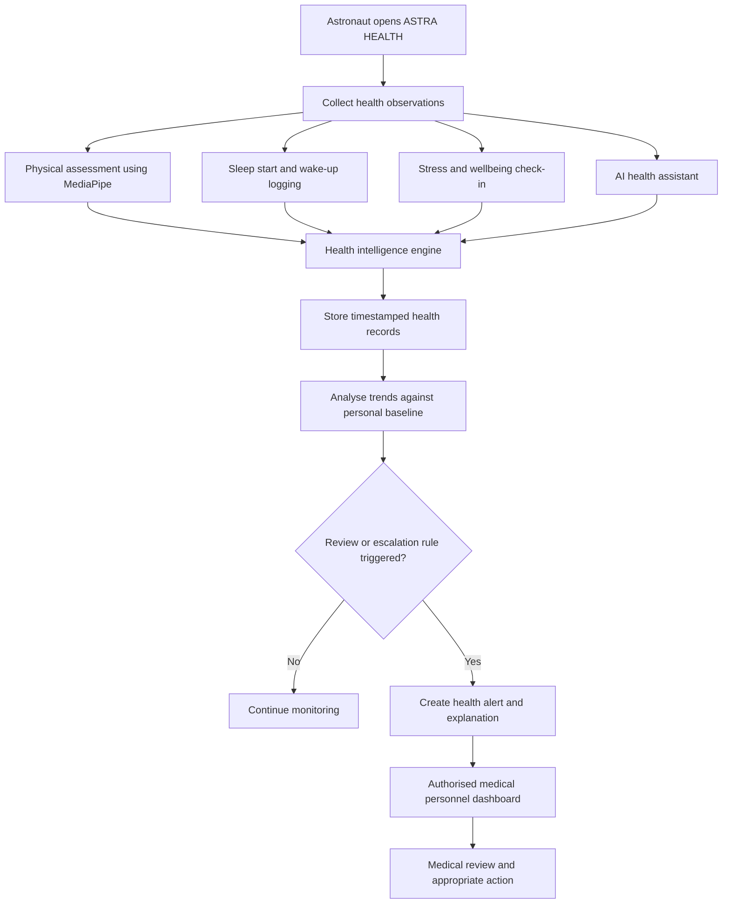
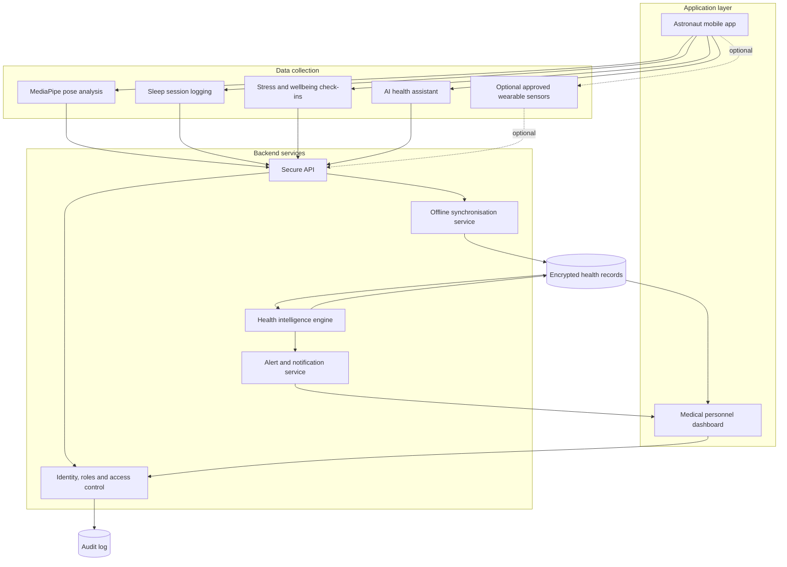
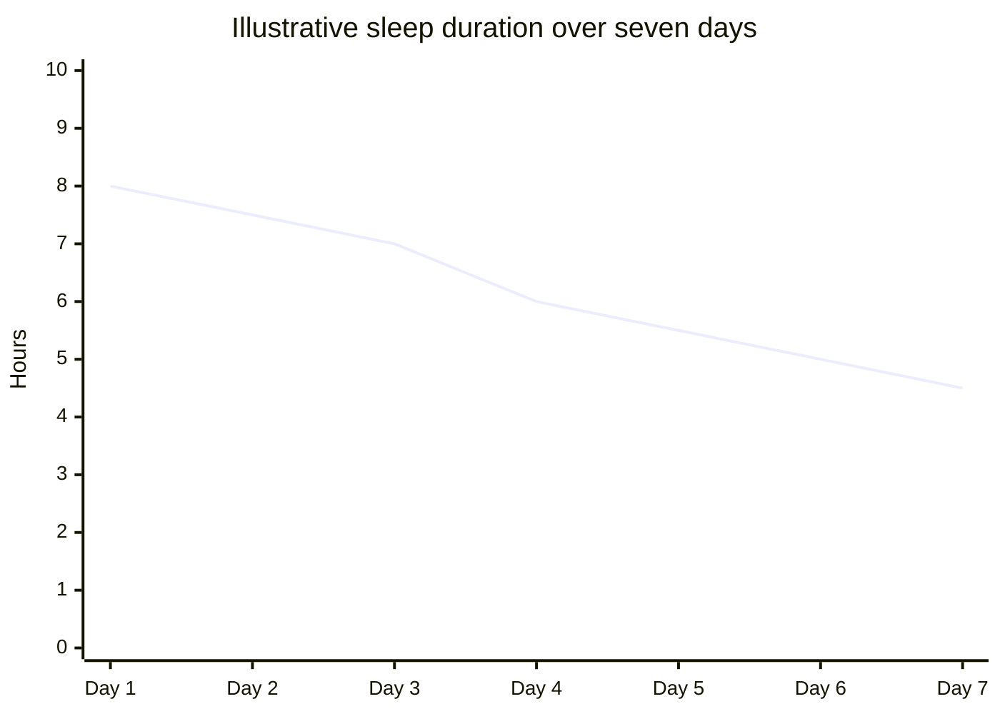

# ASTRA HEALTH

### AI-Powered Astronaut Health Monitoring and Early Warning System

<p align="center">

`{=html}
{=html}
</p>
<p align="center">

`<strong>`{=html}Continuous health insights for safer human
spaceflight.`</strong>`{=html}`<br>`{=html} A multimodal
health-monitoring concept combining computer vision, sleep and recovery
tracking, self-reported wellbeing, and AI-assisted clinical review.

</p>

<p align="center">
```
`<a href="https://developers.google.com/mediapipe/solutions/vision/pose_landmarker">`{=html}
``{=html}
`</a>`{=html} `<a href="https://reactnative.dev/">`{=html}
``{=html}
`</a>`{=html} `<a href="https://www.postgresql.org/">`{=html}
``{=html}
`</a>`{=html}
``{=html}

</p>
```

------------------------------------------------------------------------

## 1. Overview

**ASTRA HEALTH** is a proposed astronaut health-monitoring platform
designed to help track changes in an astronaut's physical performance,
sleep patterns, and self-reported mental wellbeing over time.

The system combines four primary sources of information:

1.  **Physical monitoring:** Camera-based body-pose and movement
    analysis using MediaPipe.
2.  **Sleep and recovery tracking:** Sleep-session logging, duration and
    schedule analysis, with optional wearable measurements.
3.  **Mental wellbeing monitoring:** Self-reported stress, mood, fatigue
    and symptoms.
4.  **AI health assistant:** A conversational interface that records
    health concerns and asks structured follow-up questions.

A central health intelligence service combines these records, looks for
changes against an astronaut's personal baseline, and surfaces
observations for authorised medical personnel through a separate
dashboard.

> **Important:** ASTRA HEALTH is a concept and prototype proposal, not a
> certified medical device. Its outputs are intended to support
> monitoring and clinical review---not diagnose conditions, prescribe
> treatment, or replace medical personnel.

## 2. Problem statement

Astronauts operate in an environment where changes in movement, physical
conditioning, sleep and psychological wellbeing may be important to
mission health and performance. These signals can be recorded in
separate places or may depend on an astronaut remembering to report
them.

ASTRA HEALTH proposes a unified record that brings these observations
together over time. It aims to make changes easier to notice, provide
context for medical review, and preserve a structured history of
reported symptoms and monitoring sessions.

## 3. Project objectives

-   Monitor selected posture, mobility and movement indicators.
-   Record sleep start and wake-up times and calculate sleep duration.
-   Track self-reported stress, mood, fatigue and symptoms.
-   Provide a conversational assistant for structured health reporting.
-   Build a longitudinal health profile for each astronaut.
-   Identify changes or combinations of signals that may warrant
    attention.
-   Provide authorised medical personnel with a dashboard of trends,
    observations and alerts.
-   Support secure, offline-first data capture and later
    synchronisation.

## 4. Core modules

### 4.1 Physical health and movement analysis

```{=html}
<p align="center">
```
`<a href="https://developers.google.com/mediapipe/solutions/vision/pose_landmarker">`{=html}
``{=html}
`</a>`{=html}
```{=html}
</p>
```
The mobile application uses **MediaPipe Pose Landmarker** to estimate
body landmarks from camera frames. The application analyses selected
landmarks and movement sequences to produce measurable observations.

**Potential capabilities**

-   Detect body landmarks and estimate joint positions.
-   Calculate selected joint angles and movement ranges.
-   Assess movement consistency across repeated sessions.
-   Compare left/right movement where the assessment protocol supports
    it.
-   Track changes in selected mobility indicators over time.
-   Guide the astronaut through a defined movement-assessment routine.

**Example outputs**

  -----------------------------------------------------------------------
  Indicator               Example observation     Interpretation approach
  ----------------------- ----------------------- -----------------------
  Shoulder range of       Reduced compared with   Flag for review if
  motion                  baseline                persistent

  Movement symmetry       Difference between      Compare only with a
                          sides                   suitable protocol

  Repetition consistency  Increased variation     Track change across
                                                  sessions

  Mobility score          Change from personal    Descriptive trend, not
                          baseline                a diagnosis
  -----------------------------------------------------------------------

**Space-environment limitation:** Earth-based posture assumptions and
exercise protocols cannot automatically be applied to microgravity.
Assessments must be designed and validated for the intended spacecraft
environment, camera placement, restraints and movement protocol. Pose
estimation alone does not measure overall physical health.

### 4.2 Sleep and recovery tracking

```{=html}
<p align="center">
```
`<a href="https://www.nasa.gov/humans-in-space/">`{=html}
``{=html}
`</a>`{=html}
```{=html}
</p>
```
The astronaut records two events:

-   **Sleep start:** The astronaut indicates that they are going to
    sleep.
-   **Wake-up:** The astronaut indicates that they have woken up.

The system calculates the elapsed time and maintains a history of sleep
sessions.

**Potential capabilities**

-   Sleep duration per session.
-   Sleep schedule consistency.
-   Rolling sleep-duration trends.
-   Self-reported sleep quality.
-   Sleep disturbance notes.
-   Optional integration with approved wearable or spacecraft sensors.

  -----------------------------------------------------------------------
  Data point              Collection method       Purpose
  ----------------------- ----------------------- -----------------------
  Sleep start time        Astronaut input         Start of a sleep
                                                  session

  Wake-up time            Astronaut input         End of a sleep session

  Sleep duration          Calculated              Time between recorded
                                                  events

  Rested feeling          Short questionnaire     Subjective recovery
                                                  context

  Sleep disturbance       Astronaut report or     Context for disrupted
                          validated sensor        sleep
  -----------------------------------------------------------------------

Sleep duration alone cannot establish sleep quality, physiological
recovery or stress. If available, additional validated
measurements---such as heart rate and heart-rate variability (HRV)---may
provide useful context. These measurements also require careful
interpretation and suitable sensors.

### 4.3 Stress and mental wellbeing

This module captures how the astronaut reports feeling and tracks
changes in those reports over time.

**Example check-in questions**

-   How stressed do you feel right now?
-   How would you describe your mood?
-   How energetic do you feel?
-   Are you experiencing unusual fatigue?
-   Is anything affecting your ability to rest or work?

**Tracked information**

-   Self-reported stress rating.
-   Mood and wellbeing check-ins.
-   Fatigue reports.
-   Free-text notes.
-   Changes in reported symptoms.
-   Optional physiological measurements from validated devices.

The application should clearly distinguish **self-reported stress** from
a measured physiological signal. It must not claim to infer a clinical
stress condition from sleep duration, posture or a single sensor
measurement.

### 4.4 AI health assistant

```{=html}
<p align="center">
```
`<a href="https://www.nasa.gov/humans-in-space/">`{=html}
``{=html}
`</a>`{=html}
```{=html}
</p>
```
The AI assistant gives the astronaut a conversational way to report
symptoms, concerns and changes in how they feel.

**Example astronaut messages**

-   "I've been experiencing headaches."
-   "My legs feel unusually weak."
-   "I haven't been sleeping properly."
-   "I'm feeling anxious today."
-   "I've noticed unusual pain in my shoulder."

**Assistant workflow**

1.  Understand the astronaut's message.
2.  Ask relevant, non-leading follow-up questions.
3.  Capture the reported symptom, severity, onset and duration where
    provided.
4.  Save the report with a timestamp.
5.  Associate it with the astronaut's existing health timeline.
6.  Flag predefined emergency indicators for immediate escalation under
    the mission's approved medical protocol.

The assistant should not independently diagnose, prescribe, or reassure
an astronaut that an urgent symptom is harmless. Emergency escalation
rules must be defined and approved by qualified medical personnel. The
AI should make uncertainty explicit and preserve the astronaut's
original wording.

### 4.5 Health intelligence and early-warning engine

This is the central analysis layer. It combines observations from the
other modules and compares them with the astronaut's own history.

**Inputs**

-   Movement-assessment results.
-   Sleep-session history.
-   Self-reported stress and wellbeing.
-   Symptoms and health-assistant conversations.
-   Optional approved wearable measurements.

**Processing**

-   Validate and timestamp incoming records.
-   Calculate descriptive metrics and trends.
-   Compare recent measurements with an individual baseline.
-   Identify persistent changes and combinations of observations.
-   Apply transparent, configurable alert rules.
-   Generate an explanation showing which data contributed to an alert.

**Example scenario**

An astronaut has recorded shorter sleep sessions over several days,
reports elevated stress, and shows a decline in a particular movement
assessment compared with their own baseline. The system groups these
observations into a review item for medical personnel.

The system should not label this combination as a diagnosis. It should
communicate the underlying observations, their dates, confidence or
data-quality limitations, and why a review rule was triggered.

## 5. End-to-end system workflow



## 6. High-level system architecture



## 7. Illustrative health trend graph

The following is a conceptual example of how the dashboard could display
trends. The values are fictional and are not clinical thresholds or real
astronaut data.



A production dashboard could display several separate, clearly labelled
charts:

-   Sleep duration by day.
-   Self-reported stress over time.
-   Movement assessment results against baseline.
-   Symptom reports and alert history.
-   Optional heart-rate and HRV trends.

Do not combine unrelated measurements into a single health score without
a validated methodology. If a composite indicator is introduced,
document its inputs, weighting, validation and limitations.

## 8. User interfaces

### Astronaut application

  Screen                Main functionality
  --------------------- ---------------------------------------------
  Home dashboard        Daily health overview and pending check-ins
  Physical assessment   Camera guidance and movement analysis
  Sleep tracker         Start and end sleep sessions
  Wellbeing check-in    Stress, mood and fatigue reporting
  AI assistant          Conversational symptom and health reporting
  Health history        Personal observations and trends
  Alerts                Important notifications and next steps

### Medical personnel dashboard

  Screen                Main functionality
  --------------------- -----------------------------------------------
  Overview              Astronaut status and outstanding review items
  Astronaut profile     Individual health timeline
  Physical monitoring   Movement assessment history
  Sleep analytics       Sleep duration and schedule trends
  Wellbeing             Self-reported stress and mood history
  Symptom records       Reports captured through the AI assistant
  Alerts and cases      Alert reasons, timestamps and review status
  Audit history         Access and record-change history

## 9. Technology stack

The following is a proposed implementation stack. Specific choices may
change after hardware, deployment and integration requirements are
confirmed.

  -----------------------------------------------------------------------
  Layer                   Proposed technology     Responsibility
  ----------------------- ----------------------- -----------------------
  Mobile app              React Native + Expo     Astronaut-facing
                                                  application

  Computer vision         MediaPipe Pose          Body landmark
                          Landmarker              estimation

  Movement analysis       TypeScript              Joint-angle and
                                                  movement metrics

  AI assistant            Gemini API or approved  Conversational health
                          local LLM               reporting

  Backend                 Laravel or Node.js      API and business logic

  Analytics               Python                  Trend analysis and
                                                  health rules

  Database                PostgreSQL              Structured health
                                                  records

  Local storage           SQLite                  Offline data capture

  Dashboard               React + TypeScript      Medical personnel
                                                  interface

  Charts                  Recharts                Health trends and
                                                  visualisation

  Communication           Secure API / WebSockets Data exchange and
                                                  updates
  -----------------------------------------------------------------------

### Useful technical references

-   [MediaPipe Pose
    Landmarker](https://developers.google.com/mediapipe/solutions/vision/pose_landmarker)
-   [MediaPipe
    documentation](https://ai.google.dev/edge/mediapipe/solutions/guide)
-   [React Native](https://reactnative.dev/)
-   [Expo documentation](https://docs.expo.dev/)
-   [PostgreSQL documentation](https://www.postgresql.org/docs/)
-   [Laravel documentation](https://laravel.com/docs)
-   [Recharts documentation](https://recharts.org/en-US/)
-   [NASA Human Research Program](https://www.nasa.gov/hrp/)

## 10. Data model proposal

A simplified relational data model could include:

  -----------------------------------------------------------------------
  Entity                  Example fields          Purpose
  ----------------------- ----------------------- -----------------------
  Astronaut               id, name, mission_id    Astronaut profile

  HealthProfile           astronaut_id,           Personal baseline
                          baseline_data           

  MovementSession         id, astronaut_id,       Assessment session
                          timestamp               

  MovementMetric          session_id, metric,     Extracted movement
                          value                   observations

  SleepSession            id, start_time,         Sleep records
                          end_time                

  WellbeingCheckin        id, stress_rating,      Self-reported wellbeing
                          mood, fatigue           

  SymptomReport           id, description,        Reported symptoms
                          severity, onset         

  AssistantConversation   id, astronaut_id,       Conversation history
                          timestamp               

  HealthAlert             id, reason, severity,   Review and escalation
                          status                  records

  MedicalReview           id, alert_id,           Clinical review
                          reviewer_id, outcome    

  AuditLog                id, actor_id, action,   Accountability and
                          timestamp               traceability
  -----------------------------------------------------------------------

Sensitive records should have strict access controls. The exact schema,
retention policy and permitted data flows should be agreed with the
relevant medical and mission authorities.

## 11. Security, privacy and reliability

Health information is sensitive. Security and reliability must be
treated as core requirements rather than optional enhancements.

**Security requirements**

-   Strong authentication.
-   Role-based access control.
-   Encryption in transit and at rest.
-   Secure key management.
-   Auditable access to health records.
-   Data minimisation.
-   Defined retention and deletion policies.
-   Consent and purpose-based access where applicable.

**Operational requirements**

-   Offline-first data collection.
-   Reliable local timestamps and time-zone handling.
-   Clear handling of missing or low-quality sensor data.
-   Safe synchronisation after connectivity interruptions.
-   Duplicate-event protection.
-   Visible sync and device status.
-   Defined emergency escalation procedures.

**Space deployment considerations**

-   Camera placement and lighting constraints.
-   Microgravity-specific movement protocols.
-   Device and sensor compatibility.
-   Radiation and hardware qualification where applicable.
-   Communication delays and intermittent connectivity.
-   Mission-approved medical workflows.

A prototype running on a conventional smartphone should not be
represented as flight-qualified hardware or a validated space-medicine
system.

## 12. Implementation roadmap

  -----------------------------------------------------------------------
  Phase                   Workstream              Expected output
  ----------------------- ----------------------- -----------------------
  1\. Foundation          Requirements, data      Approved prototype
                          model and UI design     scope

  2\. Physical monitoring MediaPipe integration   Working movement module
                          and guided assessments  

  3\. Sleep and wellbeing Sleep logging and       Sleep and wellbeing
                          check-in flows          records

  4\. AI assistant        Symptom capture and     Working health
                          conversation history    assistant

  5\. Intelligence engine Baselines, trend        Explainable health
                          analysis and alert      observations
                          rules                   

  6\. Medical dashboard   Profiles, charts,       Medical monitoring
                          alerts and review       interface
                          workflow                

  7\. Integration and     Offline sync, security  Integrated prototype
  testing                 and end-to-end testing  

  8\. Validation          Review with relevant    Documented limitations
                          domain experts          and validation plan
  -----------------------------------------------------------------------

## 13. Proposed MVP scope

For the first demonstrable prototype, prioritise the following:

-   [ ] Astronaut registration and secure login.
-   [ ] Astronaut home dashboard.
-   [ ] Camera-based MediaPipe pose detection.
-   [ ] At least one guided movement assessment.
-   [ ] Movement metrics saved with timestamps.
-   [ ] Sleep start and wake-up logging.
-   [ ] Sleep duration history.
-   [ ] Daily stress and wellbeing check-in.
-   [ ] AI assistant that captures symptoms and follow-up answers.
-   [ ] Central health timeline.
-   [ ] Rule-based trend and alert engine.
-   [ ] Medical personnel dashboard.
-   [ ] Astronaut profile and health history.
-   [ ] Alert review workflow.
-   [ ] Offline data storage and synchronisation.

Keep wearable integration, advanced prediction, multi-language voice
interaction and spacecraft integrations as later-stage extensions unless
the team has access to the required hardware and validated interfaces.

## 14. Evaluation and success metrics

  -----------------------------------------------------------------------
  Area                                Suggested evaluation
  ----------------------------------- -----------------------------------
  Pose estimation                     Landmark detection quality under
                                      test conditions

  Movement analysis                   Agreement with a defined reference
                                      assessment

  Sleep logging                       Completeness and accuracy of
                                      recorded sessions

  Wellbeing                           Check-in completion and trend-data
                                      completeness

  AI assistant                        Accuracy of structured symptom
                                      extraction

  Alert engine                        Sensitivity, false-alert rate and
                                      explanation quality

  Medical dashboard                   Time required to locate and
                                      interpret relevant records

  Offline operation                   Data integrity after disconnection
                                      and synchronisation

  Security                            Results of access-control and
                                      security testing
  -----------------------------------------------------------------------

Thresholds should be established through testing and expert review. Do
not claim clinical accuracy until the system has been appropriately
validated.

## 15. Future enhancements

Potential future capabilities include:

-   Integration with approved wearable devices.
-   Heart-rate and HRV trend monitoring.
-   Voice-based symptom reporting.
-   Additional computer-vision assessments.
-   Personalised movement and exercise programmes approved by medical
    personnel.
-   Mission-level health trend analytics.
-   Multilingual interaction.
-   Integration with approved spacecraft health systems.
-   More advanced anomaly detection after sufficient validated data is
    available.

## 16. Expected impact

ASTRA HEALTH aims to:

-   Improve continuity of astronaut health records.
-   Make changes in physical performance and sleep patterns easier to
    identify.
-   Give astronauts a structured way to report symptoms and wellbeing
    concerns.
-   Help medical personnel review multiple sources of health information
    in one place.
-   Support earlier human review when concerning trends appear.
-   Establish a foundation for more integrated astronaut health
    monitoring.

## 17. Project positioning

**ASTRA HEALTH is not just a fitness tracker.** It is a proposed
astronaut health-monitoring and decision-support ecosystem that combines
computer vision, longitudinal health records, conversational AI and
medical oversight.

Its core value is the ability to connect physical observations, sleep
history and self-reported wellbeing into one explainable health timeline
for the astronaut and authorised medical personnel.

------------------------------------------------------------------------

## References and resources

1.  [Google AI Edge --- MediaPipe Pose
    Landmarker](https://developers.google.com/mediapipe/solutions/vision/pose_landmarker)
2.  [NASA --- Human Research Program](https://www.nasa.gov/hrp/)
3.  [NASA --- Humans in Space](https://www.nasa.gov/humans-in-space/)
4.  [React Native](https://reactnative.dev/)
5.  [Expo](https://docs.expo.dev/)
6.  [PostgreSQL](https://www.postgresql.org/docs/)
7.  [Laravel](https://laravel.com/docs)
8.  [Recharts](https://recharts.org/en-US/)

## Disclaimer

This document describes a proposed software concept. It does not
establish that the proposed methods are clinically validated, suitable
for flight, or approved by any space agency. All medical thresholds,
emergency rules, sensor integrations, movement protocols and deployment
decisions require review and validation by qualified medical,
human-factors, engineering and mission-safety specialists.
